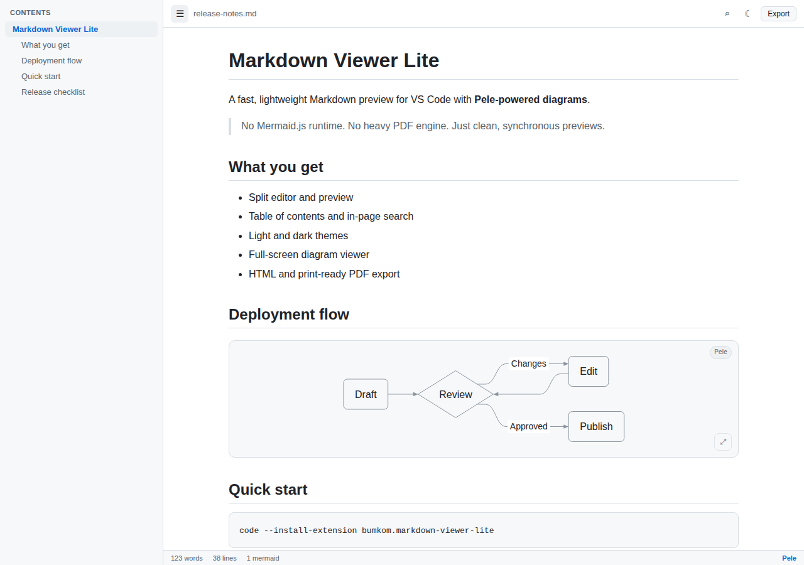
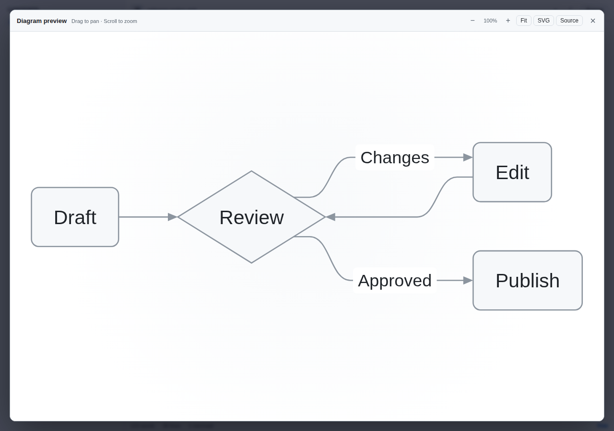
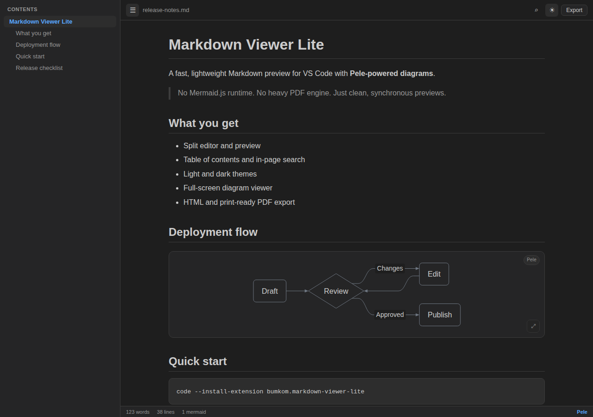

<div align="center">
  
  <h1>Markdown Viewer Lite (Pele)</h1>
  <p><strong>Fast, lightweight Markdown preview for VS Code with Pele-powered Mermaid diagrams.</strong></p>
  <p>
    <a href="https://marketplace.visualstudio.com/items?itemName=bumkom.markdown-viewer-lite">VS Code Marketplace</a>
    ·
    <a href="#install">Install</a>
    ·
    <a href="#features">Features</a>
    ·
    <a href="#faq">FAQ</a>
  </p>
  <p>
    <a href="https://marketplace.visualstudio.com/items?itemName=bumkom.markdown-viewer-lite"></a>
    <a href="https://github.com/chieund/markdown-viewer-lite/actions/workflows/ci.yml"></a>
    <a href="LICENSE"></a>
    <a href="https://github.com/chieund/markdown-viewer-lite/issues"></a>
  </p>
</div>



**Markdown Viewer Lite** is a focused Markdown preview extension for Visual Studio Code. It gives you side-by-side editing, a table of contents, in-page search, Prism syntax highlighting, and Mermaid diagrams rendered by [Pele](https://pele.run/) — without shipping Mermaid.js or a heavy PDF engine.

It is a separate extension from **Markdown Viewer Premium**, so you can install both side by side:

- Lite: `bumkom.markdown-viewer-lite`
- Premium: `bumkom.markdown-viewer-premium`

## Install

Install **Markdown Viewer Lite** from the [VS Code Marketplace](https://marketplace.visualstudio.com/items?itemName=bumkom.markdown-viewer-lite), or run:

```bash
code --install-extension bumkom.markdown-viewer-lite
```

You can also install a `.vsix` file from the [Releases](https://github.com/chieund/markdown-viewer-lite/releases) page.

**Requirements:** VS Code 1.85 or newer.

## Features

- **Split Markdown preview** — keep the editor and rendered preview side by side.
- **Pele-powered Mermaid diagrams** — flowcharts, sequence diagrams, class diagrams, state diagrams, ER diagrams, gantt, pie, journey, mindmap, timeline, Git graphs, and more.
- **Full-screen diagram viewer** — click the expand button to zoom, pan, download SVG, or copy the Mermaid source.
- **Table of contents** — follow headings and jump around long documents.
- **In-page search** — find text with match counts and next/previous navigation.
- **Syntax highlighting** — Prism highlighting for common code languages.
- **Light and dark themes** — follow VS Code automatically or toggle manually.
- **Drag and drop** — drop a Markdown file onto the preview to render it.
- **HTML and PDF export** — export a standalone HTML file, or a print-ready page for **Save as PDF**.
- **Scroll sync** — move between editor and preview using source-line markers.
- **Open files from anywhere** — open Markdown files outside the current workspace.
- **Safe by default** — rendered HTML and SVG are sanitized before display.

## Screenshots

### Full-screen diagram viewer



### Dark theme



## Usage

1. Open a Markdown file.
2. Open the preview using any of these entry points:
   - **Command Palette:** `Markdown Lite: Open Markdown Preview Lite`
   - Editor title bar: preview icon
   - Editor right-click: **Open Markdown Preview Lite**
   - Status bar: **Markdown Lite**
3. Use the toolbar to toggle the contents sidebar, search, theme, or export.

To open an arbitrary Markdown file, run **Markdown Lite: Open Markdown File in Preview Lite** and pick any `.md` file.

### Keyboard shortcuts

| Shortcut | Action |
| --- | --- |
| `Ctrl+F` / `Cmd+F` | Find in document |
| `Ctrl+D` / `Cmd+D` | Toggle light/dark theme |
| `Enter` / `Shift+Enter` | Next / previous search match |
| `Esc` | Close search or diagram viewer |
| `+` / `-` / `0` | Zoom in / out / fit diagram (viewer only) |

## Supported diagrams

Pele renders the common Mermaid diagram types used in READMEs, documentation, architecture notes, and technical design docs:

- Flowcharts
- Sequence diagrams
- Class diagrams
- State diagrams
- Entity relationship (ER) diagrams
- Gantt charts
- Pie charts
- User journey diagrams
- Mindmaps
- Timelines
- Git graphs

ZenUML and Mermaid plugins are not supported. When a diagram cannot be rendered, the preview shows an error and keeps the Mermaid source visible so nothing is lost.

## Why Markdown Viewer Lite?

- **No Mermaid.js runtime.** Diagrams are rendered synchronously by Pele, keeping the preview small and predictable.
- **Focused, not bloated.** No diagram editor, no React Flow canvas, no PlantUML, Vega, or embedded PDF stack.
- **Useful defaults.** TOC, search, scroll sync, themes, drag-and-drop, and exports are built in.
- **Works alongside Premium.** Install Lite for a fast preview, or keep Premium for its full feature set.

## Settings

| Setting | Default | Description |
| --- | --- | --- |
| `markdownViewerLite.fontSize` | `16` | Base preview font size (px). |
| `markdownViewerLite.theme` | `auto` | `auto`, `light`, or `dark`. |
| `markdownViewerLite.showToc` | `true` | Show the contents sidebar when a preview opens. |
| `markdownViewerLite.syntaxHighlighting` | `true` | Highlight fenced code blocks with Prism. |

## Export

- **Export → HTML** writes a self-contained HTML file. Relative images are inlined when the webview can read them.
- **Export → PDF (Print)** writes a temporary print-ready page and opens it in your browser. Choose **Save as PDF** in the print dialog. This keeps a PDF engine out of the extension.
- **Diagram → SVG** saves the current diagram from the full-screen viewer through the VS Code save dialog.
- **Diagram → Source** copies the original Mermaid source to the clipboard.

## FAQ

### Is Markdown Viewer Lite a replacement for Markdown Viewer Premium?

No. They are separate extensions with different trade-offs. Lite is intentionally smaller and preview-focused; Premium remains the full-featured package. Both can be installed at the same time.

### Does it bundle Mermaid.js?

No. Lite uses [Pele](https://pele.run/) for diagram rendering. Mermaid.js, React Flow, PlantUML, Vega, ZenUML, and pdfmake are not part of the Lite preview.

### How does PDF export work?

Lite creates a print-ready HTML page and opens it in your browser. Use the browser's **Save as PDF** option. This avoids embedding a PDF engine in the extension.

### Can I open Markdown files outside my workspace?

Yes. Use **Markdown Lite: Open Markdown File in Preview Lite**, or drag a Markdown file onto the preview.

### Does it work offline?

The extension and its bundled renderer work locally. Remote images or links in your Markdown still require a network connection.

### Why does a diagram show an error?

Pele supports most Mermaid diagram types, but not ZenUML or third-party Mermaid plugins. The original Mermaid source stays visible in the error panel so you can adjust it.

### How do I report a bug or request a feature?

Open an issue on [GitHub](https://github.com/chieund/markdown-viewer-lite/issues). Include your VS Code version, the Markdown snippet, and the expected result.

## Development

```bash
git clone https://github.com/chieund/markdown-viewer-lite.git
cd markdown-viewer-lite
pnpm install
pnpm build
pnpm test:e2e
pnpm package
```

The packaged VSIX is written to the repository root. Playwright tests cover rendering, search, themes, export, scroll sync, the diagram viewer, and narrow layouts.

If Playwright has not downloaded a browser yet:

```bash
pnpm exec playwright install chromium
```

## Contributing

Issues and pull requests are welcome. Keep the Lite preview focused: Pele for diagrams, no Mermaid.js runtime, and no heavy PDF dependency.

## Related

- [Markdown Viewer Premium](https://marketplace.visualstudio.com/items?itemName=bumkom.markdown-viewer-premium) — the full-featured package.
- [Pele](https://pele.run/) — the diagram renderer used by Lite.

## License

MIT © Bumkom
